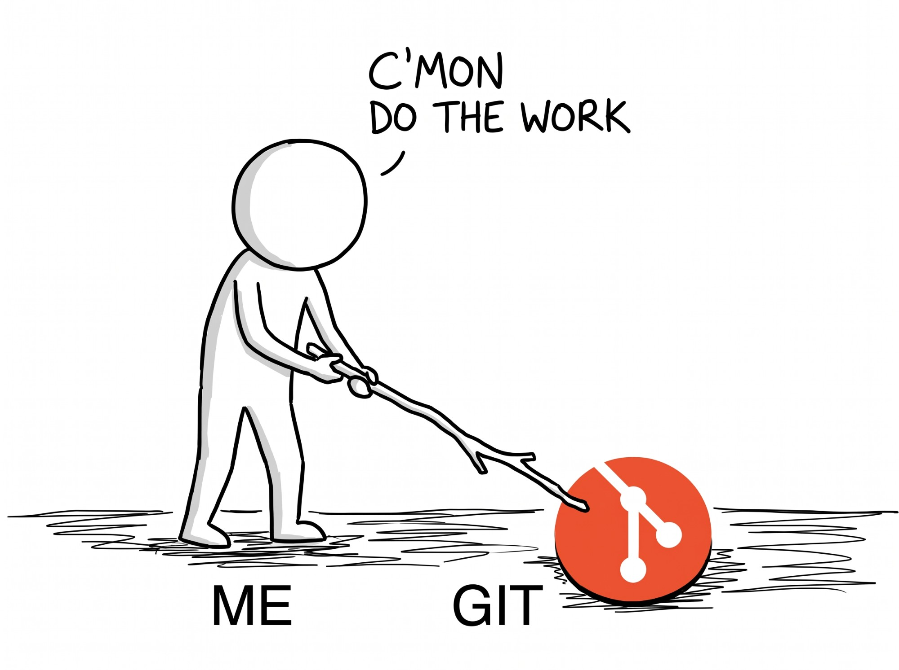

# brainsync (spike)

<p align="center">
  
</p>

With brainsync, git finally does the work.

A Claude Code skill that lets non-technical people use a GitHub repository as a **collective second brain**. They say "push" and "pull"; Claude handles saving, pull requests, merging and overlapping edits. It's a chat-native successor to [AcceleraTTy](https://github.com/zenobia-gawlikowska/acceleratty), which did the same thing with a local web UI.

## What the user sees

```
You:    push — I added notes from today's customer call
Claude: Shared! Your call notes are now in the team brain.

You:    pull
Claude: Got 3 updated notes from Alice and Bob: roadmap.md, pricing.md, ideas/pitch.md.
        Heads-up: you and Alice both edited pricing.md. Hers is the main copy now, and yours is
        saved as "pricing (your version).md". Want me to combine them?
```

## How it works

| Step | What happens behind the scenes |
| --- | --- |
| **setup** `owner/repo` | `gh repo clone` into `~/SecondBrain`. Uses the `gh` sign-in for this folder only (no global git config changes). Sets name/email from the GitHub account if missing. Locally ignores `.DS_Store`, Office lock files and Obsidian workspace files. An empty repo gets a starter README. |
| **pull** | Saves (commits) local edits → fetches → merges the shared main branch → resolves overlapping edits automatically. |
| **push** | Everything pull does, then force-updates a personal branch `brain/<login>` → opens a PR (or reuses the open one) → merges it (merge commit, then squash, then rebase, whichever the repo allows) → deletes the branch → lines local history up with main. |
| **status** | Unshared local edits, teammate updates you don't have yet, and a share still waiting for approval. |

### Overlapping edits (ported from AcceleraTTy)

Git merges as usual first, so edits to *different parts* of the same note combine silently. Only real overlaps are handled:

- **Both edited the same note**: the shared version keeps the name, and the user's version is saved as `note (your version).md` (then `(your version 2)` and so on).
- **A teammate deleted a note the user edited**: the deletion stands, and the user's copy is kept as `(your version)`.
- **The user deleted a note a teammate edited**: the teammate's version comes back.
- It works on whole file versions from git's index, so **binary files** (images, PDFs) work too, and no conflict markers ever reach the user.

Claude then offers to merge the two versions sensibly, which AcceleraTTy couldn't do.

### Edge cases covered

- **Race**: a teammate merges while our PR is being merged. Get updates, resolve, push again, retry (up to 3 times).
- **Branch protection / required review**: PR stays open, auto-merge is turned on if the repo allows it, and the user gets an approval link (exit code 2). The next push updates the same PR.
- **Squash-only or rebase-only repos**: falls back automatically, then resets local history to main so later merges stay clean.
- **Same user on two computers**: push merges `origin/brain/<login>` first, so a pending share from the other machine isn't overwritten by the force-push.
- **Interrupted run** (laptop closed mid-merge): the next command finishes or aborts the half-done merge.
- Plain-English errors for sign-in, permissions, repo not found, network trouble and files over 100 MB.

## Install (for testers)

Requirements: `git` and the [GitHub CLI](https://cli.github.com) (`brew install gh`), then `gh auth login`.

```bash
claude plugin marketplace add /path/to/brainsync
claude plugin install brainsync@brainsync
```

Then, in Claude Code: *"set up our shared brain from my-team/notes"*.

## Tests

`tests/run.sh` runs 31 end-to-end checks with two simulated users (alice and bob). They share a local bare repo through `tests/fake-gh`, a stand-in for the GitHub CLI that simulates PRs, required review, squash-only repos, races and GitHub's flaky responses. Nothing touches GitHub.

```bash
bash tests/run.sh
```

`tests/live.sh` runs the same scenarios against a **real** GitHub repository you own. Use a throwaway one: it creates PRs and toggles the squash-only setting.

```bash
bash tests/live.sh your-name/brainsync-livetest
```

### What the live run taught us (2026-11-04)

The live run happened during a real GitHub incident (Pull Requests partial outage, Git Operations degraded), so it turned up failure modes the fake never showed:

| Seen on github.com | Fix |
| --- | --- |
| `HTTP 502 Bad Gateway` on `gh pr create`, but the PR *was* created | Retry with backoff, and look for an existing PR before each retry so no duplicate is opened |
| `Merge already in progress` after a merge call returned a 502 | After any merge error, check the PR's real state (`gh pr view --json state`) before retrying |
| `remote rejected … (failure)` pushing to a branch GitHub was busy merging | Treated as temporary and retried |
| Mergeability stuck at `UNKNOWN` | Gives up after about 20 s with: *"GitHub is having trouble right now (not your fault)… your notes are saved on this computer"*. The open PR is reused on the next push |

Result: 17 of 21 live checks passed. All 4 failures come from one race scenario where GitHub's mergeability check never finished during the outage. It failed safely: nothing was lost, and the user got the plain message. Re-run `tests/live.sh` once githubstatus.com is green to confirm the race path end to end.

## Open questions for the spike

- **Trust model**: auto-merging your own PR skips review by design. For a "second brain" that's usually what people want. Teams that want review can turn on branch protection and get the approval flow.
- **Permissions**: users need write access. A fork-based flow for read-only contributors isn't built.
- **Large or binary vaults**: there's no Git LFS. GitHub's 100 MB per-file limit is only reported to the user, not worked around.
- **Background sync**: right now it only syncs when asked. A hook or scheduled `pull` could keep the brain fresh automatically.
- **Required-review flow not tested live**: branch protection on a private repo needs a paid plan, and you can't approve your own PR, so it has only been tested with the fake `gh`.
- **Second real user**: live tests simulate "bob" with the same GitHub account. Testing with a real second collaborator would also cover permissions and author names.
